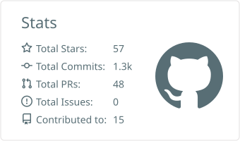
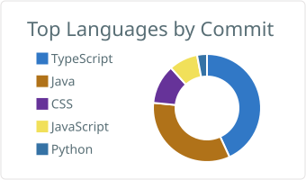
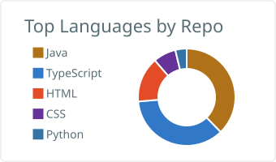
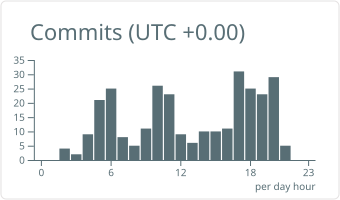

  

  
  
  

## About

I’m an IT undergraduate at the University of Moratuwa, passionate about software engineering and building reliable, real-world solutions. I enjoy learning new technologies, working in teams and turning ideas into working software.

## Tech Stack

<table>
  <tr>
    <td><b>Languages</b></td>
    <td></td>
  </tr>
  <tr>
    <td><b>Frameworks</b></td>
    <td></td>
  </tr>
  <tr>
    <td><b>Databases</b></td>
    <td></td>
  </tr>
  <tr>
    <td><b>Cloud & DevOps</b></td>
    <td></td>
  </tr>
  <tr>
    <td><b>Tools</b></td>
    <td></td>
  </tr>
</table>

## Featured Projects

| Project | Description | Stack |
|---|---|---|
| **EventFund** | Event finance management app for tracking income and expenses, member roles and invitations, a live dashboard and PDF reports (in progress) | Java · Spring Boot · React · PostgreSQL · Docker · AWS |
| **Hostelify** | Hostel management platform for room allocation, residents, payments, inventory and complaints | Java · Spring Boot · React · MySQL |
| **Green-Shadow** | Farm management platform for crops, fields, staff, vehicles and equipment | Java · Spring Boot · MySQL |
| **DressAura** | Dress rental and tailoring management system with conflict-free booking and automated late-return reminders | Java 11 · JavaFX · MySQL |

## Achievements

🥈 2nd Place, Circle Edge Creative Software Solution Awards 2024  
🥉 3rd Place, First Semester Professional Software Projects 2023

## GitHub Stats

  
  

  
  

  

